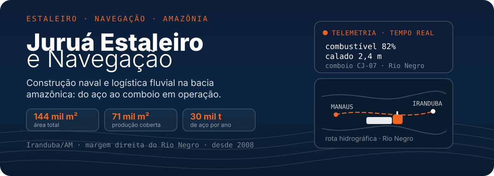
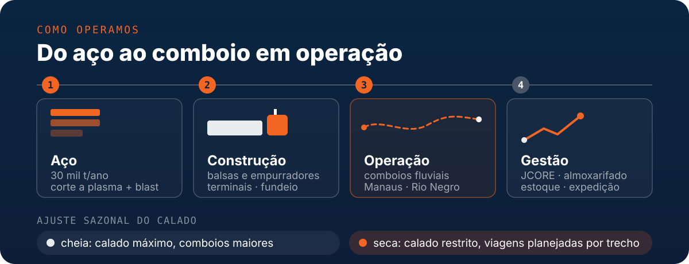

  

  

    
    
    
  

  
<strong>Construção naval e logística fluvial na bacia amazônica: do aço ao comboio em operação.</strong>

  
📍 Iranduba/AM — margem direita do Rio Negro

## Sobre a Juruá

A **Juruá** é referência na construção, manutenção naval e transporte hidroviário na Região Norte do Brasil. Unimos a tradição da engenharia naval amazônica a soluções tecnológicas para garantir eficiência, segurança e sustentabilidade no escoamento de cargas e na navegação pelos rios da Amazônia.

- **Construção & Reparo:** empurradores, balsas (grãos, fertilizantes, granéis líquidos e sólidos), barco hotel e embarcações operacionais sob projeto.
- **Infraestrutura Fluvial:** estações de transbordo, terminais portuários, sistemas de fundeio (poitas, correntes, anilhas) e acessórios como cabeços, escotilhas e tanques.
- **Logística Fluvial:** transporte integrado conectando o Polo Industrial de Manaus às principais rotas hidroviárias.
- **Tecnologia Aplicada:** primeiros passos em software próprio, com um sistema interno de gestão de almoxarifado em desenvolvimento.

## Como operamos

## Focos de desenvolvimento & engenharia

A Juruá está **começando a atuar em desenvolvimento de software**. O primeiro passo é o **JCORE**, sistema interno de gestão de almoxarifado — por isso esta frente ainda está em formação, sem portfólio de produtos publicados.

- **JCORE — sistema interno:** controle de almoxarifado, saldo por endereço, recebimento por nota fiscal, separação, picking e expedição.
- **Objetivo:** dar à operação do estaleiro informação confiável de estoque e rastreabilidade de materiais.
- **Estágio atual:** em desenvolvimento ativo dentro da empresa, com uma stack enxuta e foco em aprendizado de processo (versionamento, banco de dados e deploy).

## Stack tecnológico

A stack que usamos hoje:

| Camada | Tecnologias |
| :--- | :--- |
| **Aplicação** | `Python` `Flask` `HTML` |
| **Dados & ambiente** | `PostgreSQL` `Docker` `Git` |

## Repositórios & projetos

Além deste repositório institucional, mantemos **um único repositório de código**:

| Repositório | O que é |
| :--- | :--- |
| **`JCORE`** | Sistema interno de gestão de almoxarifado do estaleiro: saldo por endereço, recebimento por nota fiscal, separação, picking e expedição. Python + Flask + PostgreSQL. Repositório privado (*Juruá Central Operations & Resource Entry*). |

## Contato

| Canal | Endereço |
| :--- | :--- |
| **Website** | [juruaestaleiro.com.br](https://juruaestaleiro.com.br) |
| **LinkedIn** | [Juruá Estaleiro e Navegação](https://br.linkedin.com/company/juruaestaleiro) |
| **Instagram** | [@juruaestaleiro](https://www.instagram.com/juruaestaleiro/) |
| **Contato técnico** | `suporte@juruaestaleiro.com.br` |
| **Comercial** | `contato@juruaestaleiro.com.br` · +55 92 98555-6568 |
| **Estaleiro** | Rua Francisco Messias Cameli, s/n — Cacau Pirêra, Iranduba/AM — CEP 69.415-000 |
| **Trabalhe conosco** | WhatsApp (92) 98555-6506 — [juruaestaleiro.com.br/contato](https://juruaestaleiro.com.br/contato/) |

Este repositório reúne material institucional e documentação da Juruá Estaleiro e Navegação. Conteúdo, marca e projetos citados pertencem à empresa; não há licença de uso aberta por padrão.

  Construindo o futuro da navegação amazônica com engenharia, tecnologia e responsabilidade.

